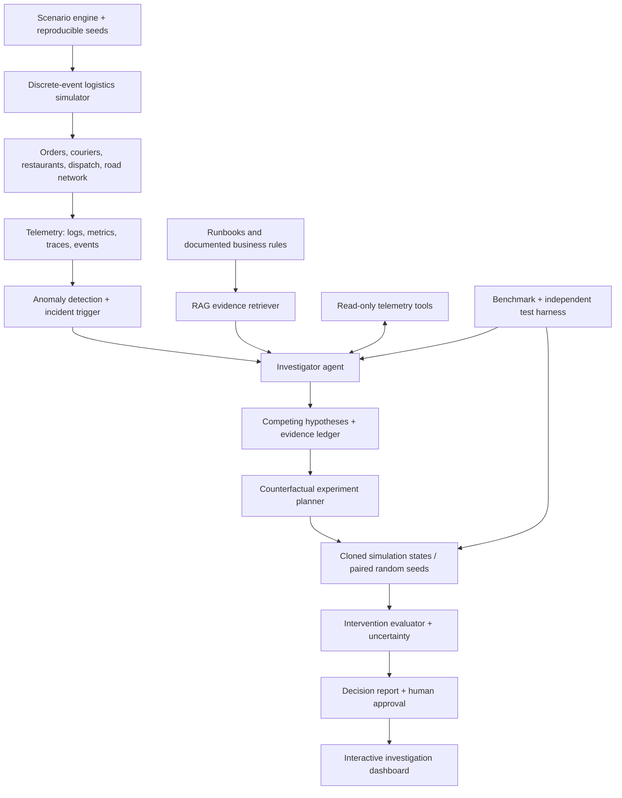

# DeliveryTwin AI — RFC 001

**Status:** Proposed architecture, research specification  
**Project type:** Open-source research and engineering platform  
**Title:** *DeliveryTwin AI: Simulation-Grounded Causal Investigation and Counterfactual Intervention for Last-Mile Logistics*  
**Development policy:** Quality- and evidence-driven milestones; no artificial calendar deadline.  
**Revision:** rev. 2 (2026-11-01) — G0 decisions recorded in `docs/decisions/` (ADR-0001…0010); consolidated architecture in `docs/architecture/ARCHITECTURE.md`. See §14.

## 1. Executive summary

DeliveryTwin AI will provide a reproducible synthetic logistics environment in which an LLM-based investigator can detect an operational incident, request evidence, formulate competing causal hypotheses, run controlled simulations of interventions, and recommend a course of action with explicit evidence and uncertainty. It is a **simulated operational environment**, not a validated digital replica of any particular delivery company's systems.

Our primary distinctive artifact is not a chatbot. It is the combination of a **causally instrumented logistics simulator**, a **tool-using research agent**, and a **public benchmark with hidden ground truth and measurable intervention outcomes**. The model component will include at least one actually trained and published PEFT/QLoRA adapter (where licensing permits), plus the corresponding reproducible training and evaluation pipeline.

**Non-goals:** Claiming causal proof about a real delivery platform from a synthetic simulator; representing synthetic company data as real; letting a generative model execute unapproved modifications to live services; reporting an improvement without rigorous independent evaluation.

## 2. Core research questions

- **RQ1 — Root-cause identification:** Does specialized fine-tuning improve correct identification of incident causes, compared with the same base model and matched prompting / retrieval tools?
- **RQ2 — Intervention selection:** Can a tool-using LLM investigator, using a controlled simulation testbed, select interventions that outperform heuristic and non-interventional baselines on held-out fault scenarios?
- **RQ3 — Robustness and generalization:** Do improvements persist across unseen locations, demand regimes, incident combinations, noise levels, and mechanism shifts?
- **RQ4 — Cost-efficiency:** What are the tradeoffs among diagnosis quality, LLM compute, tool calls, total latency, and local GPU memory?

## 3. System architecture



### Module responsibilities

| Module | Responsibility | Invariant |
|---|---|---|
| `core` | Typed contracts, deterministic seeds, simulation state, configuration | Replays reproduce the same event streams under fixed conditions. |
| `world` | Road graph, zones, demand distributions, trip times | Explicitly distinguishes observed inputs from synthetic assumptions. |
| `simulation` | Discrete-event orders, kitchens, couriers, dispatch, cancellations, bottlenecks | Hidden cause labels never appear in agent-visible telemetry. |
| `faults` | Injectable failures and documented causal mechanisms | Every fault has a known injection parameter and controlled test cases. |
| `telemetry` | Event schemas, metrics, traces, observability | Queries can be reproduced and audited. |
| `diagnostics` | Statistical detectors and classical baselines | Baselines are available without LLMs. |
| `agent` | Hypothesis generation, evidence retrieval, tool selection, reporting | Tool permissions, budget limits, explicit uncertainty. |
| `counterfactual` | State branching, seeded intervention experiments, uncertainty intervals | Paired comparisons control relevant exogenous randomness. |
| `optimization` | Policy alternatives, feasibility constraints, outcome comparison | No unrealistic or infeasible action is silently applied. |
| `training` | SFT data, PEFT/QLoRA recipes, experiment tracking | No train/test contamination. |
| `benchmark` | Held-out evaluations, ablations, confidence intervals, comparisons | Test answer keys segregated from model tools. |
| `api` / `dashboard` | Typed endpoints, interactive scenarios and explanations | Reports distinguish hypotheses from established simulated outcomes. |

## 4. Logistics simulation

### Operational entities

- **Order:** created, accepted, preparing, ready, assigned, picked up, delivered, cancelled.
- **Courier:** location, capacity, shift/availability, assignment acceptance, route, workload.
- **Restaurant:** preparation time, capacity, backlog, cancellation and availability states.
- **Dispatch policy:** nearest-courier, ETA-aware, workload-aware, batching, constraint-optimization baselines.
- **Zone and road graph:** geospatial topology, travel-time distribution, event-based congestion.
- **Infrastructure services:** dispatch API, event consumer, payment authorization mock, state synchronizer, rate limit and queue failure modes.

SimPy is a sensible discrete-event kernel. OSMnx/OpenStreetMap can supply graph topology (with attribution and applicable data license). OR-Tools can support constrained routing and dispatch baselines. Synthetic ground-truth distributions need to be documented; an OSM road network alone does not validate the resulting trip times or business behavior.

### Fault families

1. Courier scarcity and partial availability.
2. Dispatch service errors, retries, throttling, stale state and queue buildup.
3. Restaurant preparation-time bottlenecks.
4. Spatial demand surges and regional imbalance.
5. Traffic / travel-time perturbations.
6. Incorrect ETA estimation or delayed event ingestion.
7. Compound faults and cascading interactions (e.g., demand spike plus queue timeouts).

**Important:** Fault causes are explicitly injected by the scenario engine and stored in a private ground-truth channel. Agent-visible logs contain effects and partial evidence, never the injection label itself.

## 5. Counterfactual experiment protocol

When a scenario triggers an incident, the agent must propose at least two competing hypotheses, select discriminative evidence queries and, when warranted, plan interventions. The experiment harness clones a pre-intervention state and compares policy A against policy B using paired simulation seeds and compatible exogenous events.

Sample hypothesis: *Assignment queue saturation explains the observed increase in delivery lateness.*  
Proposed interventions: *Increase dispatcher capacity*, *reduce admission rate*, *change dispatch heuristic*, or *do nothing*.

Let \(Y(a;\omega)\) be a KPI measured after intervention \(a\) under exogenous realization \(\omega\). A simulation-level paired effect is:

\[
\widehat{\Delta}(a,b) = \frac{1}{n} \sum_{i=1}^n [Y(a;\omega_i)-Y(b;\omega_i)]
\]

where \(a\) and \(b\) are compared under matched seeds/exogenous conditions. Report uncertainty using repeated scenarios and appropriate confidence intervals. **This estimates effects within the modeled environment only; it does not identify real-world causal effects without external validity evidence.**

*Rev. 2 clarifications.* "Matched seeds" means **event-keyed randomness** with a counter-based generator, \(U_e = g(s, \text{event\_id}_e)\), so that interventions that change the execution path do not shift other events' noise (ADR-0002). "Cloning state" is implemented as deterministic replay to the incident time behind a `Forkable` interface (ADR-0001). The agent never receives the world's seed or internal state: experiments run either on forks of the world (lab mode A, an oracle affordance with no direct real-world analogue) or on the agent's own twin with a different seed and estimated parameters (lab mode B) (ADR-0003).

Potential KPIs include late-delivery rate, p50/p95 delivery time, unassigned-order rate, courier idle time, distance traveled, failed assignments, unfair service disparities across zones, intervention overhead and service errors. Treat optimization as multi-objective or constrained; reducing delays is not sufficient if it increases other harms or violates feasibility constraints.

## 6. LLM and agent training architecture

Use LLMs for language interpretation, evidence synthesis, typed tool choice and experimental planning—not as a substitute for a deterministic solver. The model must expose structured outputs validated against a schema. Keep all actions read-only or restricted to the isolated simulation sandbox; changes requiring approval go through a human review step.

**Baseline families:**

- Classical anomaly detection + expert-written causal heuristics.
- Untuned base language model, fixed context and prompt.
- Base model with the same tools/retrieval environment.
- PEFT fine-tuned model without tools.
- PEFT fine-tuned model with matched tools.
- Full investigative agent with a counterfactual experiment tool.

**Training targets:** fault taxonomy and evidence extraction, structured hypotheses, discriminative tool-use plans, experiments with typed parameters and reports grounded in retrieved observations. Split training and test datasets by incident mechanism, geography, demand pattern and random seed, rather than relying solely on random row shuffling. Include adversarial distractors, unresolvable cases, and incidents with multiple possible causes. Keep a human-reviewed external challenge set separate from all synthetic model-generation pipelines where feasible.

**Hardware approach:** Ubuntu with 16 GB host RAM and RTX 3050 6 GB VRAM is the local development environment. Start with a small Qwen 3 variant and confirm quantized inference + QLoRA fitting empirically. A 1.7B model may require aggressive memory optimizations; larger teacher-model experiments or model comparisons can use explicitly provisioned external compute if available. CPU-intensive simulation and analysis should remain independent of GPU model inference where practical.

**Releases:** PEFT adapter, training recipe, model card, code, decontaminated datasets, evaluation summaries and a Hugging Face demo where suitable. Model cards must disclose synthetic-data origins and limitations.

## 7. Evaluation and scientific standards

| Capability | Main metrics | Failure check |
|---|---|---|
| Incident detection | AUROC / AUPRC, time to detection, false-alert rate | Demand-regime shifts |
| Root cause | Top-1 / Top-k accuracy, macro F1, cause-set F1 | Compound incidents and causal distractors |
| Evidence quality | Support rate, attribution precision, hallucination rate | Hidden-cause leakage |
| Tool planning | Correct tool/use rate, unnecessary calls, success within budget | Injection and invalid arguments |
| Counterfactuals | Feasible-action rate, regret vs simulator oracle, paired KPI deltas | Stochastic variance, infeasible actions |
| Confidence | Calibration plots / Brier score on defined predictions | Overconfident incorrect conclusions |
| Efficiency | Wall time, tokens, hardware RAM/VRAM, energy proxy, cost | Unfair comparison of model sizes/tools |
| Generalization | Held-out mechanism / city / noise performance | Synthetic-to-real extrapolation |

Pre-register primary tasks and metrics in an experiment manifest. For each model comparison, disclose seeds, compute budget, prompts, tool budgets, training set provenance and confidence intervals. Publish ablations with one component changed at a time; avoid conflating tool access, prompt changes and fine-tuning.

*Rev. 2 additions (ADR-0006).* Primary metric is **grounded diagnosis** (correct cause plus verified causal path), reported with cause-set precision and recall, evidence closure, gain over the no-information ceiling (1/k) in observationally equivalent classes, intervention efficiency read together with accuracy, and action validity. Every agent comparison first measures a **paired noise floor** between equivalent configurations and uses it as the minimum detectable effect. Mandatory floors: random, majority class, names-only, label-free reading of the input, rule-based heuristics, and simple LLM harnesses.

## 8. Operational safeguards

- Read-only default on telemetry; no access to live courier, customer, payment or business data.
- Counterfactual interventions only affect isolated simulation state and require typed, allowlisted parameters.
- No arbitrary code execution or uncontrolled external shell calls by the LLM.
- Validate all structured outputs, limit retries/tool calls, time out stuck investigations and log every step.
- Dashboard must separate observation, hypothesis, simulator assumption, experiment, and recommendation.
- Human approval for any future operational action, and never claim this is an official or real-time system for a specific company.
- For map data, use only permissible sources with attribution and retention rules.

## 9. Visual demonstration

A browser-based control room with:

- **Operations Map:** moving couriers and orders, demand heatmap, service-level indicators, simulation speed, seeded scenario controls.
- **Incident Timeline:** anomalies, event correlation and evidence exploration.
- **Agent Investigator:** live tool calls, competing hypotheses, rationale from observed evidence, explicit uncertainty.
- **Counterfactual Lab:** clone current state, compare intervention policies side-by-side, plot paired KPI distributions and tradeoffs.
- **Research Bench:** choose models/baselines, run reproducible evaluations, view ablations and export experiment reports.

The interface should always identify the environment as simulated.

## 10. Repository layout

```text
deliverytwin-ai/
├── apps/
│   ├── api/
│   └── dashboard/
├── deliverytwin/
│   ├── core/
│   ├── world/
│   ├── simulation/
│   ├── faults/
│   ├── telemetry/
│   ├── diagnostics/
│   ├── agent/
│   ├── counterfactual/
│   ├── optimization/
│   ├── training/
│   └── benchmark/
├── configs/
├── datasets/
├── experiments/
├── notebooks/
├── tests/
│   ├── unit/
│   ├── integration/
│   ├── simulation/
│   └── benchmark/
├── docs/
│   ├── architecture/
│   ├── methods/
│   └── decisions/
├── .github/workflows/
├── pyproject.toml
├── LICENSE
├── README.md
└── CITATION.cff
```

## 11. Milestone gates (not calendar deadlines)

| Gate | Required evidence | Opens next work |
|---|---|---|
| G0: Specification | Event schema, KPI definitions, fault taxonomy, risk register, benchmark rules; **event-key catalog, world/lab/twin boundaries, investigation API, identifiability classes (ADR-0001…0006)** | Reliable simulator |
| G1: Simulator verification | Determinism/replay tests; invariant/property tests; nontrivial dispatch baselines; **zero-difference and placebo tests in CI; replay cost measured** | Fault injection |
| G2: Ground-truth benchmark | Hidden cause keys, train/test separation, reproducible incidents, classical RCA baseline | Agent investigations |
| G3: Investigator | Typed tools, traceable evidence, reproducible tool chains, no unsafe actions | Fine-tuning |
| G4: Adapted model | Trained PEFT weights, independent eval, HF model card and code | Counterfactual action planning |
| G5: Intervention research | Paired experiments, uncertainty, feasibility constraints, multiobjective metrics | Full scientific report |
| G6: Public release | CI, documentation, demo, dataset/model releases, limitations, papers/reports | Ongoing extensions |

Gate completion, not elapsed time, determines when to extend the system.

## 12. First engineering decision

Implement a **minimum scientifically valid closed loop** before adding many agent personas:

1. Generate a fixed, replayable synthetic courier-assignment bottleneck.
2. Emit logs and metrics without revealing the private fault label.
3. Show at least two diagnoses or interventions with different outcome predictions.
4. Run paired sandbox simulations to test a candidate intervention.
5. Produce an explanation distinguishing observed evidence from assumptions and simulated results.
6. Re-run the scenario and assert reproducibility in CI.

This first closed loop is the foundation for all later additions. Its scope is narrow *by design for verification*, not because of a calendar deadline. Expand sophistication after demonstrating correctness.

*Rev. 2 concrete scope for this loop:* synthetic grid city with 3 zones; two dispatch policies; three fault families (courier scarcity and dispatcher saturation as an observationally equivalent pair, plus restaurant preparation bottleneck); difficulty levels L0–L2; lab modes A and B; non-LLM baselines plus one simple LLM harness. See `docs/architecture/ARCHITECTURE.md` §6.

## 13. External references

- OpenRCA (ICLR 2025): https://proceedings.iclr.cc/paper_files/paper/2025/hash/d29b8d53678015079e1d245c023e49d2-Abstract-Conference.html
- SimPy: https://simpy.readthedocs.io/en/stable/index.html
- OSMnx: https://osmnx.readthedocs.io/en/latest/
- OR-Tools pickups and deliveries: https://developers.google.com/optimization/routing/pickup_delivery
- OR-Tools time windows: https://developers.google.com/optimization/routing/vrptw
- Hugging Face PEFT / QLoRA: https://huggingface.co/docs/peft/developer_guides/quantization
- Qwen3-1.7B: https://huggingface.co/Qwen/Qwen3-1.7B
- LangGraph execution and persistence: https://docs.langchain.com/oss/python/langgraph/persistence

## 14. Revision 2 summary (2026-11-01)

Based on `docs/methods/LITERATURE_REVIEW_001.md` and `docs/architecture/ARCH_RESEARCH_001.md`:

- **Positioning narrowed.** Agents that intervene (ACDB), hypothesis-centered RCA (HERO), discriminating-experiment selection with certificates (ISS) and digital-twin sandboxes for remediation (GuardedAct) already exist. The defensible contribution is the **protocol and benchmark**: diagnostic hypotheses tested by paired experiments in a delivery simulator with a hidden causal DAG, observational-equivalence classes with exact ceilings, and process-level evaluation. Novelty claims require full-text reading of the closest works before publication.
- **New decisions:** ADR-0001 (fork by replay), ADR-0002 (event-keyed RNG), ADR-0003 (world/lab/twin separation), ADR-0004 (investigation API), ADR-0005 (benchmark generation and difficulty ladder), ADR-0006 (evaluation and statistics), ADR-0007 (training protocol and memory gate), ADR-0008 (tool mediation), ADR-0009 (licensing), ADR-0010 (dashboard design system).
- All ADRs **accepted** by the project owner on 2026-11-01.

---

**Research integrity note:** A convincing UI is not evidence of a successful method. We will report rigorous comparisons, failure cases and negative findings, and distinguish outcomes guaranteed by simulated mechanisms from conclusions that generalize to real-world operations.
