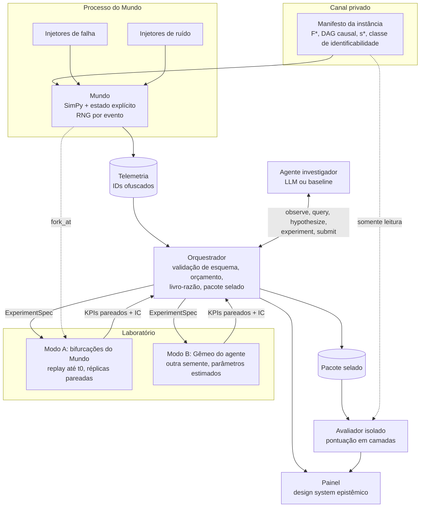

# DeliveryTwin AI — Arquitetura (v0, pós-G0)

**Data:** 2026-11-01 · **Fonte das decisões:** `docs/decisions/ADR-0001` a `ADR-0010` · **Pesquisa:** `ARCH_RESEARCH_001.md`, `docs/methods/LITERATURE_REVIEW_001.md`

## 1. Ideia em uma frase

Um mundo de entregas simulado esconde uma falha com causa conhecida; um agente investiga só pela telemetria e por **experimentos pareados** num laboratório contrafactual; um avaliador isolado pontua o diagnóstico, o raciocínio e a recomendação contra a verdade oculta.

## 2. Componentes e fronteiras

| Fronteira | Garantia | ADR |
|---|---|---|
| Canal privado → agente | Nunca atravessa. Só o Avaliador lê | 0003 |
| Mundo → agente | Só telemetria com IDs ofuscados; nunca semente ou estado | 0003, 0005 |
| Agente → Mundo | Só via Laboratório, só intervenções operacionais permitidas, custo debitado | 0003, 0004 |
| Agente → Gêmeo | Pode injetar falhas candidatas; semente e parâmetros diferentes do Mundo | 0003 |
| Agente → qualquer execução | Sempre via orquestrador, que valida antes de executar | 0008 |

## 3. Módulos (mapeados ao layout do RFC §10)

| Módulo | Responsabilidade v0 | Invariante verificado |
|---|---|---|
| `core` | Tipos pydantic (EventKey, QuerySpec, ExperimentSpec, Report), manifesto, `draw(seed, key)` | Diferença zero entre alternativas idênticas; placebo |
| `world` | Grafo viário sintético (grade), zonas, demanda, restaurantes, frota | Entradas sintéticas declaradas |
| `simulation` | Processos SimPy sobre estado explícito; `fork_at` por replay | Replay idêntico à execução contínua (hash do log) |
| `faults` | Famílias de falha com DAG de propagação; injetores de ruído separados | Portão de impacto em SLI |
| `telemetry` | Métricas, logs, traces; ofuscação de IDs por instância | Varredura de vazamento (canário) |
| `diagnostics` | Baselines sem LLM: regras, N-Sigma, classe majoritária, só nomes, RCA clássico adaptado | Disponível sem LLM |
| `counterfactual` | Laboratório modos A e B; réplicas pareadas; IC das diferenças | Razão de variâncias pareada/independente reportada |
| `agent` | Orquestrador, livro-razão, harnesses (simples e completo), ISS | Esquemas validados; orçamento respeitado |
| `benchmark` | Gerador com portões, classificação de identificabilidade, escada L0–L6, manifestos pareados, Avaliador | Avaliador em processo separado |
| `optimization` | Viabilidade e custo das intervenções | Nenhuma ação inviável aplicada |
| `training` | (G4) SFT QLoRA, decontaminação, portão de memória | Antes/depois em capacidade geral |
| `apps/api`, `apps/dashboard` | (G6) API e painel | Ambiente sempre rotulado como simulado |

## 4. Fluxo de uma sessão

1. O gerador produz uma instância (ADR-0005) e grava F*, DAG e s* no canal privado.
2. O Mundo roda até o incidente e o detector dispara o alerta.
3. O agente chama `observe`, depois `query` e `hypothesize` livremente.
4. Quando a observação não separa as hipóteses, chama `experiment`. O Laboratório bifurca em t0, roda controle e tratamento com réplicas pareadas (mesmas chaves de evento) e devolve as diferenças com IC.
5. O agente chama `submit` com causa(s), `unresolved` ou `refuted`, mais caminho causal com IDs de evidência e recomendação.
6. O orquestrador sela o pacote. O Avaliador reexecuta e pontua em camadas (ADR-0006).

## 5. Pilha técnica proposta (padrão, não pesquisado a fundo)

Python 3.12; SimPy; NumPy (`Philox`/`Threefry` por contador); pydantic v2; Parquet + DuckDB para telemetria; pytest + hypothesis para testes de propriedade; FastAPI (G6). Para modelos: Transformers/PEFT/bitsandbytes ou Unsloth (G4). Versões fixadas no `pyproject.toml` e copiadas para cada manifesto.

## 6. Escopo

### v0 = ciclo mínimo do RFC §12 (G0 → G2)

| Dentro | Fora (adiado) |
|---|---|
| 1 cidade sintética em grade, 3 zonas, ~10 restaurantes, ~30 entregadores | OSM/OSMnx, dados reais, LaDe |
| 2 políticas de despacho: mais próximo e ciente de ETA | OR-Tools, batching avançado, RL de despacho |
| 3 famílias de falha: **escassez de entregadores**, **saturação do despachante** (par equivalente), **gargalo de preparo** em restaurante | As outras 4 famílias do RFC §4 (entram em G2+) |
| Lista permitida: trabalhadores do despachante, admissão, política de despacho, incentivo, nada | Intervenções em rotas, preços |
| Laboratório modo A; modo B com gêmeo de parâmetros perturbados | Gêmeo aprendido |
| Níveis L0–L2 da escada | L3–L6 |
| Baselines sem LLM + 1 harness simples com LLM via API | Agente completo ajustado, SFT |
| Relatório em texto/JSON | Painel completo |
| CI: determinismo, replay, diferença zero, placebo, canário | — |

**Critério de saída da v0:** os seis passos do RFC §12, com o teste de diferença zero e o placebo passando em CI, e uma comparação pareada A vs. B com IC reportada para o par equivalente.

### Depois da v0 (G3 → G6)

- **G3:** agente completo e harnesses; ISS (modos A e B); piso de ruído; testes adversariais.
- **G4:** portão de memória, SFT QLoRA em Qwen3-1.7B, avaliação antes/depois.
- **G5:** escada completa, ablações H1–H11, pré-registro.
- **G6:** painel, releases, documentação de limitações.

## 7. Riscos principais e mitigação

| Risco | Mitigação |
|---|---|
| Replay lento demais | Interface `Forkable`; critério de migração na ADR-0001 |
| Benchmark fácil demais | Portões, pisos, escada; recalibrar se regras resolverem L0–L2 |
| Vazamento por nomes ou por taxa-base | Ofuscação; baselines só-nomes e classe majoritária |
| Escolha de chave de evento enviesa o pareamento | Catálogo explícito; análise slot vs. díade |
| Modelo pequeno não segue o esquema | Validação no orquestrador; resultado negativo é aceitável |

## 8. Caminho de produto (ADR-0011, ADR-0013)

| Componente da pesquisa | Papel no produto |
|---|---|
| Contrato `telemetry/v1` com `source` | Mesma interface para simulador e para ingestão de dados reais (adaptador futuro) |
| Laboratório modo B (gêmeo estimado) | Único laboratório possível em operação real |
| Nível L6 (descompasso do gêmeo) | Evidência de confiabilidade das recomendações |
| Orquestrador + aprovação humana (ADR-0008) | Nenhuma ação automática em operação real |
| Design system epistêmico | Interface do Studio e do Cloud |

Conceitos comerciais (clientes, contas, cobrança, multiusuário) ficam **fora** do pacote `deliverytwin`.
