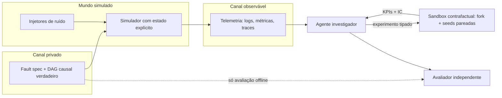

# DeliveryTwin AI — Pesquisa e Decisões de Arquitetura (ARCH-001)

**Data:** 2026-11-01 · **Complementa:** `DeliveryTwin_RFC_001.md` · **Status:** proposta para revisão
**Método:** busca de literatura e projetos (metodologia da skill `literature-research`), análise de hipóteses rivais (`hypothesis-generation`), metodologia de simulação (`simpy`), alternativas com trade-offs e recomendação (`superpowers:brainstorming`).

> **Nível de evidência.** Cada fonte abaixo está marcada: **[L]** = li a página (resumo/abstract) via fetch; **[B]** = só vi o resultado de busca, não confirmei na fonte. Vários papers são de 2026 e eu só li abstracts, não os textos completos. Números de papers diferentes **não são comparáveis** (métricas, harnesses e datasets diferem). Os scores da seção 6 são **julgamento meu**, não medição.

> **Atualização 2026-11-01 (revisão sistemática `docs/methods/LITERATURE_REVIEW_001.md`).** Uma segunda rodada, com 16 consultas no arXiv e 29 resumos lidos, **alterou** vários pontos deste documento. Onde houver conflito, vale a seção 11 ("Revisões após a revisão sistemática"). Os trechos originais foram mantidos para rastreabilidade.

---

## 1. Resumo executivo

1. **O espaço está ocupado, mas há um buraco claro.** Benchmarks de RCA com agentes (OpenRCA, OpenRCA 2.0, ORCA-bench, SREGym, AIOpsLab, ITBench) são todos **observacionais**: o agente lê telemetria e aponta a causa. Nenhum que eu encontrei deixa o agente **testar a hipótese com uma intervenção contrafactual num gêmeo simulado** antes de concluir. É esse o diferencial do DeliveryTwin. A lacuna é "não achei", não "não existe" (ver limitações, seção 9).
2. **Acertar o serviço culpado esconde raciocínio fraco.** OpenRCA 2.0 [L]: ~76% acertam ao menos uma causa, mas só ~61,5% com caminho causal verificado e só ~20,7% recuperam o conjunto exato. Estudo de trajetórias [L]: "localização correta pode esconder deficiências na reconstrução causal". Portanto a métrica primária do projeto deve ser **diagnóstico fundamentado (grounded)**, não top-1.
3. **Nosso simulador dá supervisão causal de graça.** OpenRCA 2.0 precisa de um protocolo de anotação (PAVE) para reconstruir o caminho de propagação. No DeliveryTwin o gerador de falhas **conhece o DAG causal verdadeiro**, então os rótulos passo a passo saem sem anotação humana. Isso serve para benchmark, para SFT e para recompensa de RL.
4. **Benchmarks de RCA são fáceis demais, e o nosso também será se for ingênuo.** Regras simples igualam ou superam RCA estado-da-arte em 4 benchmarks públicos [L, 2510.04711]. Logo: baseline de regras forte é obrigatório, e o gerador precisa de falhas compostas, ruído e **pares observacionalmente equivalentes**.
5. **Risco técnico que o RFC não trata:** "clonar estado" em SimPy não é trivial (geradores Python não são copiáveis/serializáveis). A arquitetura precisa de estado explícito ou de replay determinístico. Ver 4.2.
6. **O plano de treino do RFC é viável só em parte na RTX 3050 de 6 GB.** SFT QLoRA em Qwen3-1.7B é plausível; GRPO multi-turno com simulador **não está demonstrado** em 6 GB. Ver 4.6.

---

## 2. Panorama da literatura e projetos

### 2.1 RCA e agentes de SRE/AIOps

| Trabalho | Evidência | O que faz | Resultado-chave | Relevância |
|---|---|---|---|---|
| OpenRCA (ICLR 2025) | [B] | 335 falhas, 3 sistemas | melhor modelo ~11% | Referência do RFC; baseline de comparação |
| OpenRCA 2.0 (2606.27154) | [L] | 500 instâncias, rótulos causais passo a passo (PAVE) via injeção conhecida | exato 20,7%; relaxado 76,0%; fundamentado 61,5% | **Define a métrica "grounded"**; CC BY-NC-SA, sem repo linkado |
| ORCA-bench (2607.28545) | [L] | 1.079 tarefas, Prometheus/Jaeger/OpenSearch, relatos ambíguos | melhor 25,3% (médio), 10,0% (difícil); alucinação até 40%; sem código-fonte piora | Níveis de dificuldade e **taxa de alucinação** como métrica |
| Estudo de trajetórias (2608.21310) | [L] | 5.000 trajetórias, 10 configurações | falhas = evidência omitida / mal interpretada / raciocínio sem suporte | **Taxonomia de falhas** para o nosso relatório de erros |
| Benchmarks RCA "simples demais" (2510.04711) | [L] | gerador automático; 1.430 casos válidos de 9.152 injeções; 25 tipos de falha | regras ≈ SOTA nos benchmarks antigos; no novo, top-1 médio 0,21 | **Validação de casos por impacto em SLI**; baseline de regras |
| SREGym (2605.07161) | [L] | 90 problemas, injetores de falha e de ruído, falhas compostas/metaestáveis | desempenho varia até 40% por tipo de falha | **Injetores de ruído separados dos de falha** |
| AIOpsLab (Microsoft) | [B] | 48 problemas, ChaosMesh, interface agente-nuvem | detecção/localização/RCA/mitigação | Desenho de interface agente↔ambiente |
| ITBench (IBM, ICML 2025) | [B] | 94–102 cenários (fontes divergem) | agentes resolvem ~11–14% de SRE | Contexto; números inconsistentes entre versões |
| RCAEval / "How far are we" (ASE'24) | [B] | 9 métodos de descoberta causal, 21 de RCA; PC, PCMCI, RCD, CIRCA, BARO | alerta: sintético pode não refletir real | **Baselines clássicos prontos para reuso** |
| EvoCause, AgentTrace, MetaRCA | [B] | LLM + grafo causal; falhas em multiagentes | — | Híbridos LLM+grafo; não li |

### 2.2 Logística de entrega

| Trabalho | Evidência | Relevância |
|---|---|---|
| DeliveryBench (2512.19234) | [L] | Agentes jogando como entregadores em cidades 3D. É **agente-como-operador**, não agente-como-investigador. Complementar, não concorrente. Licença do código não confirmada. |
| LaDe (Cainiao, 2306.10675) | [L] | 10,7 milhões de pacotes, 21 mil entregadores, 6 meses. **CC BY-NC-SA 4.0**. Útil para calibrar tempos de serviço/viagem. Cobre last-mile de encomendas, não restaurantes. |
| Meituan / INFORMS TSL | [B] | Simuladores de entrega a partir de dados reais; não confirmei que o simulador é aberto. |
| DRL para serviços sob demanda (survey) | [B] | Aponta simuladores abertos de ride-hailing (DiDi), não de comida. |
| Batching/buffering de despacho (2024) | [B] | Base para políticas de despacho com buffer de tempo. |

**Achado:** não encontrei simulador aberto de entrega de comida com injeção de falhas operacionais e rótulo causal. Isso é lacuna a confirmar, não prova.

### 2.3 Contrafactual, pareamento de seeds e desenho de experimentos

| Trabalho | Evidência | Relevância |
|---|---|---|
| CRN em simulação a eventos discretos (WSC, GaTech, SMDM) | [B] | Variância das diferenças pareadas cai com números aleatórios comuns; IC de meia-largura 0,35 → 0,12 em um estudo de coorte. Procedimentos padrão de seleção assumem amostras independentes, e CRN quebra isso. |
| "When Does Pairing Seeds Reduce Variance?" (2512.24145) | [L abstract] | Redução estrita de variância **quando as saídas são positivamente correlacionadas por seed**. Não li condições de falha nem teoremas. |
| LLM Agents Perform Controlled Experiments Using Simulation Models (2608.23622) | [L abstract] | Mais próximo do nosso loop (desenhar experimento → simular → recomendar), mas em processos farmacêuticos, avaliação qualitativa, sem código. |
| BED-LLM (ICLR 2026) | [B] | LLM escolhe a próxima pergunta por ganho esperado de informação. Vantagem cresce com mais turnos. Modelos fortes ganham menos. |
| CLadder / Corr2Cause | [B] | LLMs próximos do acaso em inferência causal a partir de correlação; ajuste fino ajuda mas não generaliza a perturbações. **Justifica não confiar só no LLM para causalidade.** |

### 2.4 Treino e ambientes

| Trabalho | Evidência | Relevância |
|---|---|---|
| OpenEnv (HF, Meta-PyTorch, Unsloth, Modal, Prime Intellect…) | [B] | API estilo Gymnasium (`reset/step/state`) cliente-servidor, MCP de primeira classe. Candidato a camada de ambiente. |
| Verifiers / Environments Hub (Prime Intellect) | [B] | Ambiente = dataset + harness + rubrica de recompensa; integra OpenEnv. |
| Unsloth GRPO + QLoRA | [B] | GRPO funciona com QLoRA; guia recomenda rubrica de várias recompensas verificáveis, ≥1,5B, 500+ passos. |
| Supervisão de processo em agentes (IPR, CSO, ProRAG) | [B] | Recompensa por passo por rollouts de Monte Carlo é ruidosa; supervisão verificada em pontos críticos é mais limpa. **Nosso simulador fornece rótulos verificados.** |
| Abstenção conformal (2405.01563 e outros) | [B] | Calibra quando abster. Lacuna: o que ocorre quando a causa verdadeira não está no conjunto candidato. |

---

## 3. Análise de lacunas

| Aspecto | OpenRCA 1/2 | ORCA-bench | SREGym/AIOpsLab/ITBench | DeliveryBench | LLM+simulação (2608.23622) | **DeliveryTwin** |
|---|:-:|:-:|:-:|:-:|:-:|:-:|
| Ground truth oculto verificável | ✔ | ✔ | ✔ | — | — | ✔ |
| Rótulo causal passo a passo | ✔ (anotado) | parcial | — | — | — | ✔ (**gerado**) |
| Agente intervém para testar hipótese | — | — | mitigação em sistema vivo | — | ✔ (pharma) | ✔ (**sandbox pareado**) |
| Controle de variância (seeds pareadas) | — | — | — | — | — | ✔ |
| Pares observacionalmente equivalentes | — | — | — | — | — | ✔ (proposto) |
| Domínio logística de entrega | — | — | — | ✔ (operador) | — | ✔ |
| Treino de modelo pequeno com reward do simulador | — | — | — | — | — | ✔ (proposto) |

Lacunas candidatas, cada uma com um risco de "alguém já fez com outro nome": (G1) diagnóstico validado por intervenção contrafactual; (G2) rótulos causais gratuitos do simulador usados para SFT/RL; (G3) benchmark com classes de equivalência observacional; (G4) abstenção calibrada em casos irresolúveis por observação. **Nenhuma dessas é reivindicação de novidade.** Precisa de uma busca sistemática com `paper-search` (skill labrat) antes de qualquer afirmação em paper.

---

## 4. Decisões de arquitetura

### 4.1 Princípio central: separar três canais

O agente tem **dois** tipos de acesso: leitura observacional da telemetria e **experimentos tipados** no sandbox. O avaliador é o único que cruza o canal privado, e fica em processo separado.

### 4.2 Núcleo de simulação: estado explícito, não "clone de SimPy"

**Problema.** O RFC §5 pede "clonar o estado pré-intervenção". Em SimPy o estado vive em corrotinas (geradores), e geradores Python não podem ser copiados com `deepcopy` nem serializados com `pickle`. Isto é limitação da linguagem, não de configuração.

**Opções:**

| Opção | Como bifurca | Prós | Contras |
|---|---|---|---|
| A. SimPy + **replay determinístico até t**, depois fork | Reexecuta do início com as mesmas seeds até o instante do incidente e então aplica a intervenção | Usa a skill/ecossistema SimPy; simples; reprodutível por construção | Custo O(t) por fork; exige que **nenhum** efeito dependa de ordem de consumo de RNG |
| B. Kernel próprio de eventos com **estado em dataclasses** (heap de eventos + snapshot) | `copy.deepcopy`/serialização do estado | Fork O(estado); snapshots persistíveis; treino RL rápido | Perde SimPy; mais código a verificar |
| C. Mesa/agent-based genérico | — | Rápido para protótipo | Fraco em filas/recursos; não pesquisei a fundo |

**Recomendação:** começar com **A** (cumpre o ciclo mínimo da §12 do RFC com menor risco) mas com a camada `simulation` escrita contra uma interface `Snapshot/Fork`, para migrar para **B** se o custo de replay ou o treino RL exigir. Registrar como ADR. *Não medi o custo de replay; isso é um experimento do G1.*

### 4.3 Pareamento de seeds: um fluxo de RNG por fonte estocástica

A skill `simpy` recomenda um stream por fonte estocástica e uma substream por replicação, evitando `random.seed()` global, para que uma chamada de demanda numa alternativa não vire chamada de serviço na outra. Regras do projeto:

- Streams nomeados: `demand`, `prep_time`, `travel_time`, `courier_availability`, `dispatch_errors`, `noise`.
- Seed derivada = `hash(base_seed, stream, replicação)`; registrar todas.
- **Intervenções que alteram o número de sorteios** (ex.: adicionar couriers) desalinham o stream. Mitigação: pré-gerar os sorteios exógenos por entidade/ID de pedido (ex.: tempo de preparo do pedido N sorteado na criação), não por ordem de consumo.
- Teste de CI: duas alternativas idênticas devem produzir diferença exatamente 0 (valida o pareamento).
- Reportar **IC da diferença pareada** e comparar com o IC não pareado para mostrar o ganho. Pareamento só reduz variância se houver correlação positiva por seed (2512.24145, abstract); medir, não presumir.
- Aviso da literatura de seleção: métodos que assumem independência entre alternativas não valem sob CRN. Usar apenas diferenças pareadas por replicação.
- Para experimentos grandes/paralelos, considerar gerador com substreams testados (NumPy `SeedSequence`/`Generator` ou similar); hash de seeds **não prova** independência (aviso da própria skill).

### 4.4 Gerador de falhas: DAG causal explícito, ruído separado, equivalência observacional

- Cada falha é um **nó raiz de um DAG de propagação** (ex.: `queue_saturation → assignment_delay → late_delivery`). O DAG verdadeiro vai para o canal privado e gera o rótulo passo a passo.
- **Injetores de falha ≠ injetores de ruído** (padrão do SREGym [L]): ruído ambiente (picos benignos, eventos de feriado, travel-time perturbado) não é a causa.
- Falhas compostas e em cascata desde o G2, não depois.
- **Validar cada caso por impacto em SLI** (padrão de 2510.04711 [L]): descartar injeções sem efeito observável. Reportar a taxa de descarte.
- **Classes de equivalência observacional (ideia nossa, a validar):** pares de falhas cujas assinaturas na telemetria são indistinguíveis sem intervenção (ex.: escassez de couriers vs. throttling de aceitação). Nesses casos a resposta correta é *"não identificável só por observação; rodar experimento X"*. Isso mede exatamente o que o contrafactual agrega e dá o teste de abstenção.
- Teste de vazamento: um "canário" textual no rótulo privado que nunca pode aparecer em nenhuma saída visível; e checagem de que nomes de parâmetros de injeção não aparecem em logs.

### 4.5 Agente: loop tipado de investigação com contabilidade de hipóteses

Pipeline por incidente: **detectar → listar ≥2 hipóteses → escolher a próxima ação por informação esperada → executar (consulta ou experimento) → atualizar crenças → decidir/abster → relatar.**

- A escolha da próxima ação usa **ganho esperado de informação** (BED-LLM, ICLR 2026 [B]) aproximado: o LLM propõe hipóteses e o resultado esperado de cada consulta sob cada hipótese; o orquestrador determinístico calcula o ganho. Isto mantém o LLM como gerador/intérprete e o cálculo como código (coerente com o RFC §6). Aviso: modelos fortes ganham menos com esse artifício; vale ablação.
- Saídas **validadas por schema**; orçamento de chamadas; timeout; log de cada passo (já no RFC §8).
- Relatório separa observação / hipótese / suposição do simulador / experimento / recomendação (RFC §8), e inclui o caminho causal citando evidências por ID.
- **Orquestração:** loop próprio tipado + máquina de estados explícita. LangGraph (citado no RFC) é opcional para persistência; não pesquisei alternativas (smolagents etc.), então a escolha fica aberta.

### 4.6 Treino do modelo: escada com portões

| Etapa | O que | Viabilidade em 6 GB | Evidência |
|---|---|---|---|
| T0 | Baseline sem treino (Qwen3-1.7B / 4B) + mesmas ferramentas | Inferência 4-bit: sim | — |
| T1 | **SFT QLoRA** com traços gerados do simulador (rótulos de processo verificados) | 1,7B: plausível; 4B: apertado, contexto curto, batch 1 | [B] estimativas indiretas; **medir `max_memory_allocated`** |
| T2 | Destilação de professor (modelo maior, via compute externo) → traços para T1 | Fora da GPU local | custo/licença a decidir |
| T3 | **RLVR/GRPO** com recompensas do simulador (rubrica: formato, hipótese correta, caminho causal, experimento viável, custo) | **Não demonstrado em 6 GB** para multi-turno; Unsloth cita GRPO em 1,7B com ~5 GB só em cenário simples | [B] |
| T4 | Recompensa de processo com rótulos do DAG | depende de T3 | [B] |

**Recomendação:** tratar T1 como o G4 mínimo; T3 como *stretch* condicionado a (a) fork rápido (opção B de 4.2) e (b) compute externo ou um teste de memória bem-sucedido. A rubrica de recompensa múltipla é a prática recomendada pelo guia da Unsloth [B]. Não prometer RL no README até medir.

### 4.7 Interface de ambiente: OpenEnv/MCP como camada fina

Expor o simulador como ambiente `reset/step/state` com ferramentas MCP (telemetria somente leitura + experimento tipado). Vantagens: o mesmo ambiente serve a avaliação, à demo e ao treino; compatível com Verifiers/Environments Hub [B]. **Risco:** o ecossistema OpenEnv é novo e só conferi via um post de blog e busca; manter o núcleo independente e o adaptador fino.

### 4.8 Avaliação

Mudanças em relação ao RFC §7:

| Métrica | Origem | Por quê |
|---|---|---|
| **Diagnóstico fundamentado** (causa certa + caminho causal verificado) | OpenRCA 2.0 | Principal; top-1 sozinho é enganoso |
| Conjunto exato de causas + F1 | OpenRCA 2.0 / RFC | Compostas |
| Taxa de alucinação (causa implausível) | ORCA-bench | Já no RFC como "hallucination rate" |
| Falhas por categoria (evidência omitida / mal interpretada / sem suporte) | 2608.21310 | Relatório de erros |
| Regret contra o oráculo do simulador | RFC | Intervenções |
| Acerto de abstenção em pares equivalentes | proposto | Mede o valor do contrafactual |
| Calibração (Brier/ECE), cobertura conformal | RFC + [B] | Confiança |
| Custo/latência/VRAM | RFC | RQ4 |

Baselines obrigatórios: (1) regras especialistas; (2) métodos de RCEval/RCAEval adaptados (PC, PCMCI, RCD, CIRCA, BARO) *quando a telemetria for compatível*; (3) LLM base sem/com ferramentas; (4) SFT sem/com ferramentas; (5) agente completo com experimento. Adaptar RCA de microsserviços a logística exige mapear "serviços" para entidades (zonas, dispatcher, restaurantes); esse mapeamento é trabalho de pesquisa, não plug-and-play.

### 4.9 Calibração com dados reais (opcional, G6)

LaDe [L] pode calibrar tempos de serviço e distribuições de viagem, mas é **CC BY-NC-SA 4.0**. Se o repositório for MIT/Apache, os *parâmetros ajustados* provavelmente são derivados — questão a resolver com cuidado. Alternativa: publicar o script de calibração e **não** os parâmetros. Isso preserva a honestidade do RFC (o mundo é sintético; calibração só torna as distribuições plausíveis, não valida o simulador).

---

## 5. Hipóteses rivais e como testá-las

Aplicando a disciplina da skill `hypothesis-generation` (hipótese ≠ evidência; sempre ter rival):

| ID | Hipótese | Rival | Teste que discrimina | Se o rival vencer |
|---|---|---|---|---|
| H1 | Experimento contrafactual melhora diagnóstico fundamentado | Ganho vem só de mais chamadas de ferramenta/compute | Ablação com **mesmo orçamento de chamadas**, trocando experimento por consultas extras | Reposicionar como "ferramentas", não "contrafactual" |
| H2 | SFT com rótulos de processo do simulador melhora raciocínio | Modelo decorou assinaturas sintéticas | Split por **mecanismo/cidade/ruído** + conjunto desafio revisado por humanos | Reportar como resultado negativo de generalização |
| H3 | EIG melhora a seleção de evidência | LLM forte já escolhe bem sozinho | Ablação EIG vs. escolha livre por tamanho de modelo | Manter como baseline, não como contribuição |
| H4 | Seeds pareadas reduzem variância das diferenças | Correlação por seed baixa | Razão de variâncias pareada/não pareada por KPI e por tipo de intervenção | Aumentar réplicas; documentar |
| H5 | Pares equivalentes testam o valor do contrafactual | Equivalência é artefato do nosso gerador | Revisão por especialistas + variação dos geradores | Descartar a classe |

Qualquer hipótese que dependa de "o modelo entende causalidade" deve lembrar que LLMs ficam perto do acaso em Corr2Cause [B]: o desenho coloca a causalidade no **simulador e no avaliador**, não no LLM.

---

## 6. Matriz de decisão (julgamento, escala 1–5)

Critérios e pesos: Risco técnico (×3, maior = menor risco), Valor científico (×3), Viabilidade local 6 GB (×2), Custo de implementação (×2, maior = mais barato), Reprodutibilidade (×2).

| Decisão | Risco | Valor | Local | Custo | Repro | **Total /60** |
|---|:-:|:-:|:-:|:-:|:-:|:-:|
| Fork por **replay** sobre SimPy (A) | 4 | 3 | 5 | 5 | 5 | **49** |
| Kernel próprio com snapshot (B) | 3 | 4 | 5 | 2 | 4 | 41 |
| Métrica primária = diagnóstico **fundamentado** | 5 | 5 | 5 | 4 | 5 | **56** |
| Rótulos causais **gerados** pelo simulador | 4 | 5 | 5 | 4 | 5 | **53** |
| Pares de **equivalência observacional** | 3 | 5 | 5 | 3 | 4 | 47 |
| Seleção de ação por **EIG** | 3 | 4 | 4 | 3 | 4 | 41 |
| SFT QLoRA 1,7B (T1) | 4 | 3 | 4 | 4 | 4 | 43 |
| GRPO multi-turno local (T3) | 1 | 5 | 1 | 1 | 2 | 24 |
| Camada OpenEnv/MCP | 3 | 3 | 5 | 3 | 4 | 38 |
| Calibração com LaDe | 3 | 3 | 5 | 3 | 3 | 36 |

Leitura: o que mais pesa em valor com risco baixo é métrica fundamentada, rótulos gerados e replay-fork. RL local fica de fora do caminho crítico.

---

## 7. Ordem de entrega sugerida (mapeada aos gates do RFC)

- **G0** — adicionar ao RFC: ADR de fork (4.2), política de streams (4.3), métrica fundamentada (4.8), política de licenças (4.9), definição de "equivalência observacional".
- **G1** — Determinismo + **teste de diferença zero entre alternativas idênticas** + medir custo do replay.
- **G2** — Gerador com DAG causal, ruído separado, validação por SLI, baseline de regras; medir quanto o baseline de regras já resolve (se resolver demais, o benchmark está fácil).
- **G3** — Agente com consultas tipadas e relatório; medir taxa de alucinação e categorias de falha.
- **G4** — SFT QLoRA; **medição de VRAM antes de prometer RL**.
- **G5** — Experimentos pareados, abstenção em pares equivalentes, ablação H1.

---

## 8. Riscos

| Risco | Prob. | Impacto | Mitigação |
|---|:-:|:-:|---|
| Fork por replay lento demais para RL | média | alto | Interface `Snapshot/Fork`; migrar para B |
| Benchmark sintético fácil demais (regras resolvem) | alta (literatura) | alto | Compostas, ruído, equivalência; reportar baseline de regras |
| Vazamento do rótulo na telemetria | média | alto | Canário + auditoria automatizada em CI |
| Desalinhamento de RNG sob intervenções que mudam sorteios | alta | médio | Sorteios exógenos por ID de entidade; teste de diferença zero |
| Modelo pequeno não segue schema/ferramentas | média | médio | Decodificação restrita a schema; baseline com 4B |
| Licença LaDe vs. repo aberto | média | médio | Publicar só o script |
| Reivindicar novidade sem busca sistemática | média | alto | Rodar `paper-search` + encadeamento de citações antes de qualquer claim |
| Dependência de ecossistema novo (OpenEnv) | média | baixo | Adaptador fino |

---

## 9. Limitações desta pesquisa

- Li **abstracts/páginas de resumo**, não os textos completos. Não verifiquei teoremas nem tabelas.
- Várias fontes são **[B]**: só resultados de busca. Não deve ser citado em paper sem leitura.
- A ferramenta `paper-search` da skill labrat não foi executada (instalação bloqueada). A segunda rodada usou as APIs do arXiv e do Semantic Scholar; limitações em `LITERATURE_REVIEW_001.md`, seção 7. Os itens [B] acima continuam não verificados, exceto os que a seção 11 cita.
- Não pesquisei: frameworks de agentes alternativos ao LangGraph, avaliação com Inspect/Harbor, simuladores de tráfego (SUMO), ETA learning, justiça entre zonas (RFC §5), segurança de agente além do RFC.
- Estimativas de VRAM são indiretas. Nenhum número foi medido na sua máquina.
- Muitos IDs arXiv são de 2026 e vieram de buscas; os fetches carregaram, mas a revisão por pares não foi verificada.

---

## 11. Revisões após a revisão sistemática

Fonte: `docs/methods/LITERATURE_REVIEW_001.md`. Itens lidos em resumo; números a conferir nos PDFs.

| # | O que eu disse acima | O que a revisão mostrou | Mudança de decisão |
|---|---|---|---|
| R1 | Seção 1, item 1 e seção 3: "nenhum que eu encontrei" testa hipóteses por intervenção em simulador | Há peças adjacentes: **A2P** (2509.10401, contrafactual imaginado pelo LLM, 47,46% vs. 16,67%), **GuardedAct** (2609.11264, sandbox de gêmeo digital valida ações de remediação; dano colateral 25,6% → 5,2%), AgentRCA (2607.22385), 2608.23622 | **Rebaixar** G1: a novidade defensável é a *combinação* (hipóteses de diagnóstico testadas por experimentos pareados num simulador com causa oculta e avaliação independente), não "contrafactual com LLM". Ler os textos completos dos 6 candidatos antes de qualquer claim |
| R2 | 4.3: sorteios exógenos "por ID de entidade" | **2603.11084**: PRNG com estado quebra CRN quando a intervenção muda o caminho de execução; solução = RNG **de contador (Philox/Threefry) indexado por ID de evento** | **Adotar**: cada sorteio = f(base_seed, stream, event_id). Substitui a ideia de pré-gerar sorteios por entidade. NumPy oferece `Philox` e `Threefry` como *bit generators* (conhecimento geral; confirmar a versão instalada) |
| R3 | 4.8: métricas e comparações | **2606.20695**: medir o *noise floor* da discordância pareada entre configurações **equivalentes** antes de declarar ganho; 7/10 efeitos relatados ficavam abaixo desse piso | **Adicionar** protocolo "noise-floor" ao G1/G5: rodar A vs. A' (idênticas em semântica, seeds distintas) e usar o piso como limiar mínimo de efeito |
| R4 | 4.5: seleção da próxima ação por ganho esperado de informação | **CaRDI** (2608.27847): trocar entropia por **risco calibrado e custo da ação** reduz a perda em 21,5% (domínio clínico) | EIG vira **baseline**, não decisão. Candidata: valor esperado da informação ponderado por custo da consulta/experimento e por severidade do erro operacional. Testar na ablação H3 |
| R5 | 4.5: "loop próprio tipado" com agente em pipeline fixo | **Free to Look** (2610.35767): *harnesses* simples (uma chamada sobre pacote de evidência; agente SQL; agente de código) superam 5 agentes publicados (PR@1 65–77% vs. 16–53%) | Incluir esses 3 *harnesses* como **baselines obrigatórios**. O agente completo precisa vencê-los com o mesmo orçamento; manter pipeline mínimo e evitar procedimentos rígidos |
| R6 | 4.4: "baseline de regras forte" | Reforçado: o gerador de telecom (2610.30004, Apache-2.0) tem regra simples 0,650 vs. método temporal 0,575. Também mostra caso em que ranquear dispositivos alarmados dá **0,000** (perda de energia do site) | Baseline de regras mantido. O caso de perda de energia é **modelo concreto de par observacionalmente equivalente** (ideia 4.4) |
| R7 | 4.8: "diagnóstico fundamentado" como métrica principal | Confirmado por OpenRCA 2.0, estudo de trajetórias e 2602.09937 (1.675 runs; alucinação na interpretação persiste em todos os modelos). **R2Act** (2607.04623): diagnóstico certo, mas ação inválida em 39,5–62,0% dos casos | Incluir **validade da ação/intervenção** (viável e admissível) como métrica irmã da fundamentação. Reforça o módulo `optimization` com checagem de viabilidade |
| R8 | 4.6: GRPO local "não demonstrado" | **AOI** (2603.03378): GRPO em modelo local de 14B supera Sonnet 4.5 em falhas inéditas (AIOpsLab) segundo o resumo; trajetórias falhas viram supervisão corretiva. Contrapeso: **2607.18725** — fine-tuning de LLMs pequenos pode piorar o desempenho | Mantém T3 como *stretch*, agora com precedente de 14B (fora da sua GPU). Adicionar à escada de treino a etapa "supervisão a partir de trajetórias falhas" e **um controle**: checar se o SFT piora o modelo base nos baselines |
| R9 | 4.8: avaliação | **SRE-Marathon** (2609.33023): pacote selado + pontuação offline determinística; **2609.29522**: propostas congeladas reproduzidas sem LLM-juiz | **Adotar**: cada investigação gera um *sealed bundle* (trajetória, seeds, versão); o avaliador reexecuta de forma determinística, sem LLM-juiz para a nota principal |
| R10 | 2.2: "não achei simulador aberto de entrega" | Existem **LLM-DR** (2603.12559, código e dados publicados), **RideGym** (2607.10173, interface Gym), **ICAPS-DPDP** (2202.01256) | Usar como **referência de interface e baseline de despacho**, não como concorrentes diretos. O nicho "injeção de falhas operacionais + causa oculta" segue sem exemplo que eu tenha achado |
| R11 | 4.4: gerador de falhas | Gerador aberto de alarmes com causa exata e caminho de propagação já existe em outro domínio (2610.30004) | G2 deixa de ser contribuição por si. Estudar o desenho (esquema, *scorer*, splits) e reutilizar convenções |
| R12 | Visualização/dashboard | **TraceBench** (2608.27182): agentes usam melhor saída numérica que gráficos | Ferramentas do agente devem ser textuais/tabulares; o dashboard é para humanos |

### Rodada 2 (multi-base, `paper-search`; ver LR-001, seções 9–12)

| # | Achado | Mudança de decisão |
|---|---|---|
| R13 | **ACDB** (2609.31675): agentes LLM com intervenções orçadas em SCM; PC com heurística ativa vence LLMs; LLMs comprometem demais | G1 em causalidade genérica não é novo. **Adotar** a API *observe–intervene–submit* e a pontuação em 3 camadas (estrutura, DAG, eficiência de intervenção). Incluir **baseline clássico de aprendizado ativo** (PC + orientação ativa) |
| R14 | **ISS** (2609.32247): intervenção que separa candidatos sobreviventes; certifica concordância | Implementar como **política não-LLM de seleção de experimento** (oráculo/baseline) sobre o conjunto finito de hipóteses×parâmetros do gerador; critério de parada formal para investigação |
| R15 | *Did It Happen?* e *Recovery Credit*: pares de estados ocultos atrás de observação idêntica, **teto exato sem informação** (0,5) | Formalizar pares equivalentes como **fibras observacionais** e reportar o **teto sem informação** (1/k para k causas indistinguíveis). Métrica: ganho sobre o teto ao usar a ação discriminativa. Reforça a ideia 4.4 e reduz seu risco |
| R16 | **Heuresis** (2610.22846): nomes das variáveis sozinhos dão 99% das direções | **Vazamento por nomes é real.** Telemetria visível com identificadores ofuscados/randomizados por cenário, e baseline "só nomes". Teste de CI: agente sem dados, só com nomes, deve ficar no acaso |
| R17 | **Where Does the Accuracy Come From?**: agente 0,44 < detector 0,60 < N-Sigma 0,80; evidência mostrada +0,30, prompt +0,05; decoy 21–42%; erro de início de 2 min derruba 0,87→0,27 | Baseline obrigatório **"leitura sem rótulo da entrada"**; testes com **decoy** e **deslocamento de início**; ablação do texto de evidência; pré-registro (já no RFC §7) |
| R18 | **HERO** (observacional, crença explícita, SR 79,77) e **EviDiag/EviDx** | O livro-razão de hipóteses e o valor da informação **não são contribuição**; são baselines. O diferencial permanece o experimento contrafactual pareado |
| R19 | **Cloud-OpsBench**: snapshot de estado reexecutado; fechamento de evidência 0,38/0,15 vs. acurácia 0,76/0,68 | Fork por snapshot é prática aceita. **Adicionar métrica de fechamento de evidência** (fração dos nós do DAG causal verdadeiro cobertos por evidência citada) |
| R20 | **Telecom SLM** (1,5B, LoRA): sensível à serialização; confusão entre classes quase equivalentes; **Agent-trace FT**: esquecimento catastrófico escondido na perda | Protocolo T1: perda só sobre a completude, replay de domínios, decontaminação, **checagem de capacidade geral antes/depois**, teste de **robustez à serialização** da telemetria. Reconhecer que os precedentes de 16 GB não valem para 6 GB |
| R21 | **ToolGuard**: SLMs 1–4B com 47–52% de sucesso de ataque em tool-calling | Teste adversarial do agente com parâmetros fora da lista permitida; validação de esquema no orquestrador, nunca no modelo |
| R22 | **Same Noise, Better Gradients** (CRN em gradiente de política) e *Reproducible AI Requires Reproducible Randomness* | Para o stretch T3 (GRPO): reutilizar ruído de transição entre amostras do mesmo grupo. **Fixar versão e implementação do RNG** e registrá-las no manifesto |

### Efeito na matriz da seção 6 (julgamento)

- "Pares de equivalência observacional": valor ↑ (R6 dá um exemplo concreto), risco ↓.
- "Seleção por EIG": valor ↓ como contribuição; passa a ser baseline (R4).
- "Contrafactual com LLM" como novidade: valor ↓ (R1); a contribuição é o protocolo e o benchmark, não a ideia.
- Novo item "baselines de harness simples": risco baixo, valor alto para honestidade científica (R5).

### Hipóteses adicionais

| ID | Hipótese | Rival | Teste |
|---|---|---|---|
| H9 | O agente usa a ação discriminativa nos pares equivalentes e passa do teto sem informação | A estrutura do prompt/ferramenta já induz o uso; ou o agente chuta | Teto 1/k vs. desempenho com/sem ferramenta de experimento; ablação por ordem das ferramentas (R15) |
| H10 | Ofuscar identificadores derruba a acurácia de um agente que só vê nomes | Nomes não vazam a causa neste domínio | Baseline "só nomes" antes/depois da ofuscação (R16) |
| H11 | A política ISS escolhe experimentos com menos chamadas que o agente LLM | O LLM aproveita conhecimento de domínio que ISS ignora | Comparar custo até certificação/parada com o mesmo orçamento (R14) |
| H6 | O ganho do agente completo desaparece frente a um *harness* simples com o mesmo orçamento | A estrutura do agente importa em falhas compostas | Comparar nos mesmos splits por tipo de falha (R5) |
| H7 | CRN por evento reduz a variância das diferenças pareadas mais que seeds por stream | Intervenções mudam tantos eventos que o ganho é pequeno | Razão de variâncias em 3 tipos de intervenção (R2) |
| H8 | O piso de ruído entre configurações equivalentes é pequeno frente aos efeitos de intervenção | Estocasticidade do simulador domina | Protocolo noise-floor (R3) |

---

## 10. Fontes

**Lidas [L]:**
[OpenRCA 2.0](https://arxiv.org/abs/2606.27154) · [ORCA-bench](https://arxiv.org/abs/2607.28545) · [Estudo de trajetórias RCA](https://arxiv.org/abs/2608.21310) · [Benchmarks RCA realistas](https://arxiv.org/abs/2510.04711) · [SREGym](https://arxiv.org/abs/2605.07161) · [DeliveryBench](https://arxiv.org/abs/2512.19234) · [LaDe](https://arxiv.org/abs/2306.10675) · [Pairing seeds](https://arxiv.org/abs/2512.24145) · [LLM agents + simulation models](https://arxiv.org/abs/2608.23622)

**Só por busca [B]:**
[OpenRCA (ICLR 2025)](https://proceedings.iclr.cc/paper_files/paper/2025/hash/d29b8d53678015079e1d245c023e49d2-Abstract-Conference.html) · [AIOpsLab](https://arxiv.org/abs/2501.06706) · [ITBench](https://mlanthology.org/icml/2025/jha2025icml-itbench) · [RCA "How far are we"](https://arxiv.org/abs/2408.13729) · [BED-LLM](https://proceedings.iclr.cc/paper_files/paper/2026/hash/87eb265e8898a7e245d61f01cea4d906-Abstract-Conference.html) · [Corr2Cause](https://arxiv.org/abs/2306.05836) · [OpenEnv](https://huggingface.co/blog/openenv-agentic-rl) · [Unsloth RL guide](https://unsloth.ai/docs/get-started/reinforcement-learning-rl-guide) · [Conformal abstention](https://arxiv.org/abs/2405.01563) · [CRN, GaTech](https://www2.isye.gatech.edu/~sman/courses/6644/Module10-ComparingSystems-201128.pdf) · [CRN, WSC 2001](https://informs-sim.org/wsc01papers/053.PDF) · [EvoCause](https://arxiv.org/abs/2607.27290) · [AgentTrace](https://arxiv.org/abs/2603.14688)
